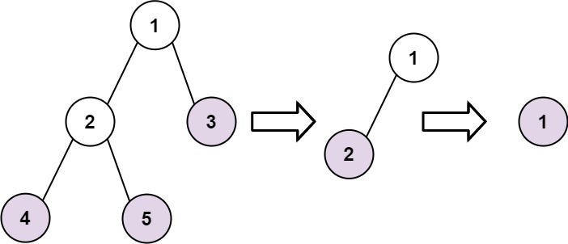

# [366. Find Leaves of Binary Tree](https://leetcode.com/problems/find-leaves-of-binary-tree/description/)

Given the root of a binary tree, collect a tree's nodes as if you were doing this:

- Collect all the leaf nodes.
- Remove all the leaf nodes.
- Repeat until the tree is empty.


### Example 1:

> Input: root = [1,2,3,4,5]
>
> Output: [[4,5,3],[2],[1]]
>
> Explanation:
>
> [[3,5,4],[2],[1]] and [[3,4,5],[2],[1]] are also considered correct answers since per each level it does not matter the order on which elements are returned.


### Example 2:
> Input: root = [1]
>
> Output: [[1]]
 

### Constraints:
- The number of nodes in the tree is in the range `[1, 100]`.
- `-100 <= Node.val <= 100`


## Solutions

### Performance

- **Time Complexity**: $O(n)$
- **Space Complexity**: $O(n)$

### Javascript
```javascript

```

### Performance

- **Time Complexity**: $O(n)$
- **Space Complexity**: $O(n)$

### Python
```python
class Solution:
  def getHeight(self, node: Optional[TreeNode], res: List[List[int]]) -> int:
    if not node:
      return -1
    
    leftHeight = self.getHeight(node.left, res)
    rightHeight = self.getHeight(node.right, res)
    
    currentHeight = 1 + max(leftHeight, rightHeight)
    
    if currentHeight == len(res):
      res.append([])

    res[currentHeight].append(node.val)

    return currentHeight

  def findLeaves(self, root: Optional[TreeNode]) -> List[List[int]]:
    res = []
    self.getHeight(root, res)
    return res
```
